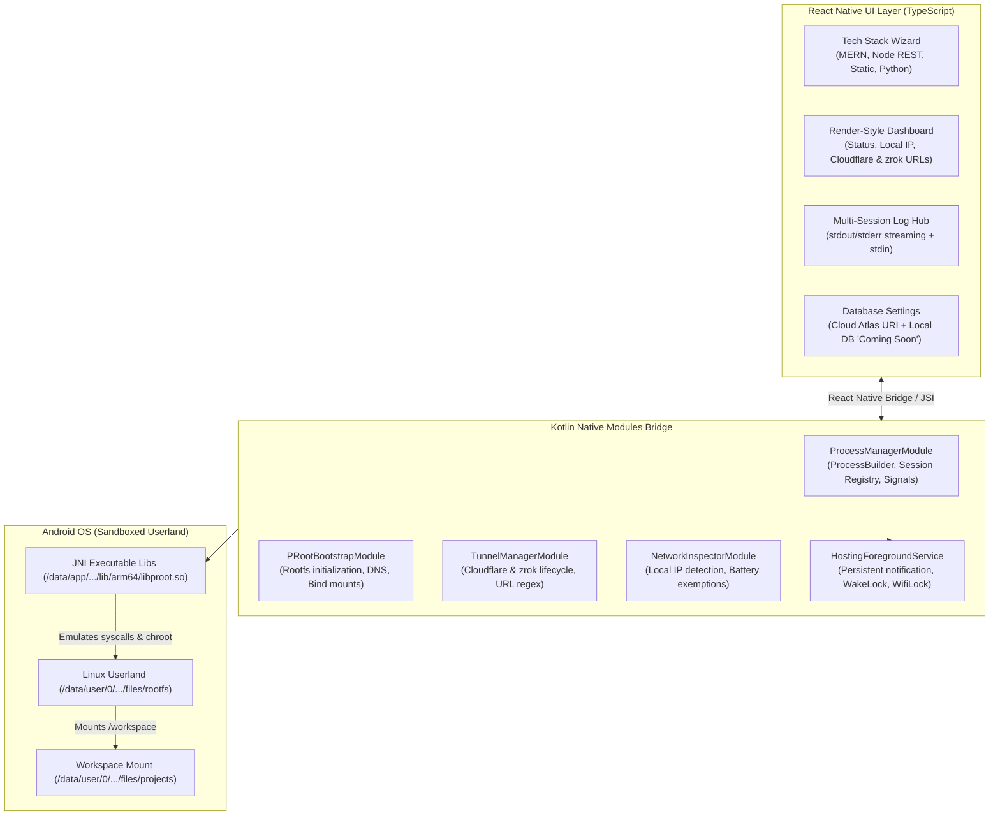

# 🚀 PocketHost — Pocket "Render" for Android

> **Turn any Android device into a pocket cloud hosting server.** Host MERN stack backends, Express REST APIs, static web apps, and Python services directly on your smartphone with instant public HTTPS URLs.

---

## 🌟 Key Highlights

- **100% Mobile Self-Hosted**: Runs full backend runtimes (Node.js, Express, Python) directly on Android hardware.
- **Render-Style GUI**: Simple, clean, developer-friendly interface without intimidating raw terminal commands.
- **Zero External Apps Required**: All Linux PRoot userland binaries run inside the app's internal sandbox. No Termux app installation needed.
- **Instant Public Access (Like Render)**:
  - 🌐 **Cloudflare Quick Tunnel**: Free instant public HTTPS URL (`https://*.trycloudflare.com`).
  - ⚡ **zrok Tunnel**: Fast, secure peer-to-peer/public tunnel powered by OpenZiti (`https://*.share.zrok.io`).
  - 📶 **Local Wi-Fi Network**: Access over LAN (`http://192.168.x.x:PORT`).
- **Android Foreground Service**: Keeps services alive 24/7 with a persistent status notification, `WakeLock`, and `WifiLock` (compliant with Android 14 `specialUse` / `dataSync` policies).
- **Multi-Session Terminal & Logs**: Stream build logs, server runtime stdout/stderr, and tunnel outputs in real-time with stdin command support.
- **Database Architecture**:
  - ☁️ **Cloud Database (Active)**: Full support for MongoDB Atlas connection URI (`MONGODB_URI`).
  - 🗄️ **Local MongoDB Engine**: Distinct preview card with **COMING SOON** badge.

---

## 🏛️ Architecture Overview



---

## 📁 Project Structure

```
mobile_hosting/
├── android/                                    # Android Native Project
│   ├── app/
│   │   ├── build.gradle                        # NDK, ABI filters (arm64-v8a), dependencies
│   │   └── src/main/
│   │       ├── AndroidManifest.xml             # Foreground Service permissions (Android 14)
│   │       └── java/com/pockethost/
│   │           ├── MainActivity.kt             # ReactActivity entry point
│   │           ├── MainApplication.kt         # Registers Kotlin native bridge
│   │           ├── bridge/
│   │           │   ├── HostingBridgePackage.kt # Registers all native modules
│   │           │   ├── ProcessManagerModule.kt # Multi-session runner, stdout/stderr/stdin
│   │           │   ├── PRootBootstrapModule.kt # Linux PRoot sandbox & mount bindings
│   │           │   ├── TunnelManagerModule.kt  # Cloudflare & zrok tunnel runner & URL parser
│   │           │   └── NetworkInspectorModule.kt# Wi-Fi IP, port checker, battery opt
│   │           ├── service/
│   │           │   ├── HostingForegroundService.kt # 24/7 background service with WakeLock
│   │           │   └── NotificationHelper.kt   # Android 8.0+ notification channels
│   │           └── model/
│   │               ├── ProcessSession.kt       # Session lifecycle & stream handlers
│   │               └── SessionType.kt          # Process types (Server, Tunnel, Build)
├── src/                                        # React Native Application (TypeScript)
│   ├── components/
│   │   ├── Header.tsx                          # Top bar with Live status pill
│   │   ├── Card.tsx                            # Dark glassmorphic card container
│   │   ├── Button.tsx                          # Primary, secondary, danger, success buttons
│   │   ├── Badge.tsx                           # Status badges
│   │   ├── ComingSoonBadge.tsx                 # Distinct "Coming Soon" badge
│   │   ├── StatusIndicator.tsx                 # Animated pulsing status dot
│   │   └── TabBar.tsx                          # Bottom navigation bar
│   ├── screens/
│   │   ├── StackSelectionScreen.tsx            # Visual tech stack cards (MERN, Node, etc.)
│   │   ├── DependencySetupScreen.tsx           # Step-by-step GUI progress installer
│   │   ├── ProjectConfigScreen.tsx             # Port, entry file, source, .env variables
│   │   ├── DatabaseConfigScreen.tsx            # MongoDB Atlas + Local DB Coming Soon
│   │   ├── DashboardScreen.tsx                 # Render deployment overview & URLs
│   │   └── TerminalLogScreen.tsx               # Multi-session log viewer with stdin prompt
│   ├── native/                                 # Native bridge wrappers with simulation mode
│   │   ├── NativeProcessManager.ts
│   │   ├── NativePRootBootstrap.ts
│   │   ├── NativeTunnelManager.ts
│   │   └── NativeNetworkInspector.ts
│   ├── store/
│   │   └── AppContext.tsx                      # Central reactive state store & actions
│   ├── theme/
│   │   └── colors.ts                           # Modern dark cloud palette
│   ├── types/                                  # TypeScript interfaces & enums
│   ├── utils/
│   │   ├── starterTemplates.ts                 # Pre-built MERN, Node, and Python templates
│   │   └── formatters.ts                       # Uptime and memory formatters
│   └── App.tsx                                 # Application root
├── package.json
└── tsconfig.json
```

---

## 🛠️ Android Compatibility & Permissions (Android 8.0 - 14+)

To ensure uninterrupted background hosting without Android battery optimization terminating services:

1. **SELinux & Android 10+ (API 29+) Binary Execution (`W^X`)**:
   - Android blocks executing binaries directly from `/data/data/.../files/`.
   - The PRoot executable is packaged as a JNI library (`libproot.so`) inside `jniLibs/arm64-v8a/`. Android automatically places it in the read-only, executable system directory `/data/app/.../lib/arm64/libproot.so`, satisfying all SELinux policies!
2. **Android 14+ (API 34) Foreground Service Policies**:
   - Declares `android:foregroundServiceType="specialUse|dataSync"`.
   - Includes `PROPERTY_SPECIAL_USE_FGS_SUBTYPE` documenting developer hosting usage.
3. **Battery Saving Exemption**:
   - In-app 1-click button prompts `ACTION_REQUEST_IGNORE_BATTERY_OPTIMIZATIONS` to prevent OEM task killers from freezing Node.js servers when the screen turns off.

---

## 🚀 How to Build and Run

### 1. Install Node Dependencies
```bash
npm install
```

### 2. Connect Android Device via USB
Ensure USB Debugging is turned on in your device Developer Options:
```bash
adb devices
```

### 3. Run on Android
```bash
npx react-native run-android
```

Or assemble the standalone APK:
```bash
cd android
./gradlew assembleDebug
```
The resulting APK will be located at:
`android/app/build/outputs/apk/debug/app-debug.apk`

---

## 💡 How Deployments Work in the App

1. **Pick Tech Stack**: Select **MERN Stack**, **Node.js REST API**, **Static Web App**, or **Python**.
2. **Dependency Setup**: The app initializes an isolated Linux userland directly on the phone with zero root required.
3. **Configure Project**: Set port, pick project source (Upload ZIP, Folder, or Starter Template), and add `.env` keys.
4. **Database (Optional)**: Paste your MongoDB Atlas URI.
5. **Start Hosting**:
   - The Android Foreground Service activates with a persistent status notification.
   - The backend server binds to your chosen port.
   - Cloudflare Quick Tunnel and zrok tunnels automatically establish and stream back a live public HTTPS URL!
6. **Share & Monitor**: Copy the public URL or local Wi-Fi URL, open in any browser worldwide, and watch live runtime logs in the Terminal tab!
